# Moving clang-tidy into a FeatureModule

A visual walkthrough of squashed commit [`c64f1fca38c6`](https://github.com/ArcsinX/llvm-project/commit/c64f1fca38c610faa448c14c5336808087b1996e) (`Moved clang-tidy into feature module`), compared with its parent [`101584320859`](https://github.com/ArcsinX/llvm-project/tree/101584320859c12c84929443136e9deb54de544a).

17 changed files: **+624 / −408**. All source links are pinned to these exact snapshots.

The main change is ownership: clang-tidy logic formerly embedded in ParsedAST.cpp and Diagnostics.cpp moves into ClangTidyFeatureModule and its per-build TidyASTListener. Core parsing orchestration stays in place.

Original explanatory comments and existing FIXMEs move together with their code. Their wording is retained; indentation and line wrapping may change. New comments explain module ownership and wiring. [See figure 19](#19-code-moves-together-with-its-original-comments).

Matching remains a direct MatchFinder call: no consumer wrapper, takeover or reinitialization is introduced. The parent already contains four relevant regression tests; this patch adds the provider-swap test and adapts existing setup. No lit test is added.

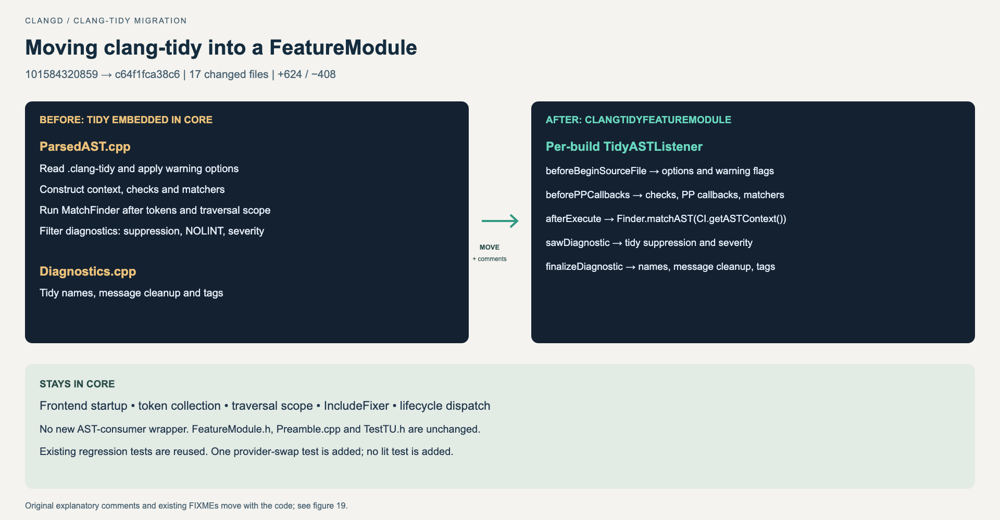

## Reading the diagrams

Amber (−) marks lines removed at the shown location; green (+) marks added lines; gray marks unchanged context. Colors follow the actual git diff. Arrows map the responsibility described by the figure, not every line in its excerpts.

These are source-rendered before/after images, not IDE screenshots. Displayed code is verbatim, line numbers are original, and omitted spans are marked. File paths are relative to clang-tools-extra/clangd/ unless they begin with llvm/. Every displayed source line and highlight is audited against Git.

This is not entirely a literal move: provider ownership, filename preservation, generic metadata handling and caller adapters are called out separately.

The generic diagnostic callback contract is unchanged. Location-less errors from custom tidy checks still bypass sawDiagnostic, so tidy-specific suppression of those errors is not preserved. Built-in location-less configuration warnings were already filtered out.

[Open the hosted walkthrough](https://arcsinx.github.io/clang-tidy-feature-module-walkthrough/) · [Complete patch](migration.patch) · [Snapshot metadata](snapshot.json)

## Lifecycle map

| Existing hook | Tidy module responsibility |
| --- | --- |
| `beforeBeginSourceFile()` | Read configuration and apply warning options before frontend initialization |
| `beforePPCallbacks()` | Create the context/checks and register PP callbacks and matchers |
| `afterExecute()` | Call Finder.matchAST() directly after tokens and traversal scope are finalized |
| `sawDiagnostic()` | Apply tidy suppression/severity policy and identify tidy diagnostics |
| `finalizeDiagnostic()` | Supply fallback metadata, clean messages and attach tidy tags |

The module no longer overrides beforeExecute(). FeatureModule.h and Preamble.cpp are unchanged. Preamble builds do not run tidy checks, as before.

## Core code retained by the migration

| Retained block | Before | After |
| --- | --- | --- |
| Frontend startup and beforeBeginSourceFile dispatch | [L546](https://github.com/ArcsinX/llvm-project/blob/101584320859c12c84929443136e9deb54de544a/clang-tools-extra/clangd/ParsedAST.cpp#L546) | [L371](https://github.com/ArcsinX/llvm-project/blob/c64f1fca38c610faa448c14c5336808087b1996e/clang-tools-extra/clangd/ParsedAST.cpp#L371) |
| beforeExecute dispatch | [L760](https://github.com/ArcsinX/llvm-project/blob/101584320859c12c84929443136e9deb54de544a/clang-tools-extra/clangd/ParsedAST.cpp#L760) | [L494](https://github.com/ArcsinX/llvm-project/blob/c64f1fca38c610faa448c14c5336808087b1996e/clang-tools-extra/clangd/ParsedAST.cpp#L494) |
| Token finalization and traversal restriction | [L770](https://github.com/ArcsinX/llvm-project/blob/101584320859c12c84929443136e9deb54de544a/clang-tools-extra/clangd/ParsedAST.cpp#L770) | [L504](https://github.com/ArcsinX/llvm-project/blob/c64f1fca38c610faa448c14c5336808087b1996e/clang-tools-extra/clangd/ParsedAST.cpp#L504) |
| afterExecute dispatch | [L786](https://github.com/ArcsinX/llvm-project/blob/101584320859c12c84929443136e9deb54de544a/clang-tools-extra/clangd/ParsedAST.cpp#L786) | [L514](https://github.com/ArcsinX/llvm-project/blob/c64f1fca38c610faa448c14c5336808087b1996e/clang-tools-extra/clangd/ParsedAST.cpp#L514) |

## Detailed before / after views

### 1. Configuration and compiler warning options

**MOVE + ADAPT.** Only tidy options and warning handling move into the listener; frontend startup stays in ParsedAST. Action, MainInput, BeginSourceFile and the beforeBeginSourceFile hook loop remain unchanged. Use clangd's remapped main-file spelling; normalize only a relative fallback before configuration lookup.

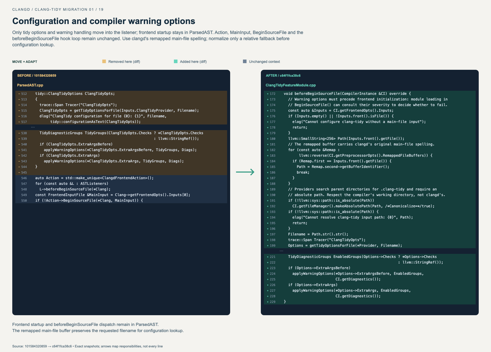

[Scalable image](assets/01-options.svg)

- Frontend startup and beforeBeginSourceFile dispatch remain in ParsedAST.
- The remapped main-file buffer preserves the requested filename for configuration lookup.
- Only configuration lookup and warning handling move. Action, MainInput, BeginSourceFile and lifecycle dispatch remain core responsibilities.

### 2. Tidy-specific helpers and linker dependencies

**MOVE + CLEANUP.** The warning-group parser, warning mapper, fast-check filter and force-linker leave ParsedAST.cpp and live with the module. Selected excerpts represent the helper bodies; the full diff includes every moved line. filterFastTidyChecks becomes filterFastChecks; original helper comments and FIXMEs move with the code.

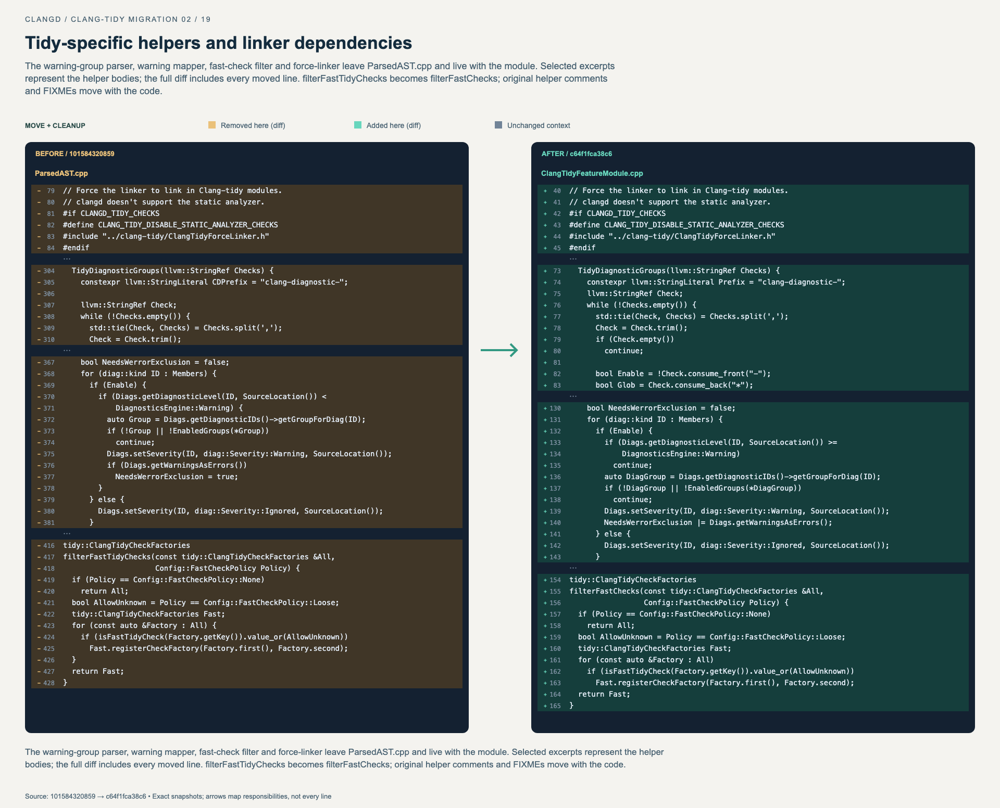

[Scalable image](assets/02-helpers.svg)

- The warning-group parser, warning mapper, fast-check filter and force-linker leave ParsedAST.cpp and live with the module. Selected excerpts represent the helper bodies; the full diff includes every moved line. filterFastTidyChecks becomes filterFastChecks; original helper comments and FIXMEs move with the code.
- Selected excerpts show the helper responsibilities; migration.patch contains every moved line. filterFastTidyChecks is renamed filterFastChecks.

### 3. Per-build state and ClangTidyContext

**MOVE + OWNERSHIP.** Stack-local tidy state becomes per-build listener state. Context outlives its checks and MatchFinder; matching is invoked directly after parsing.

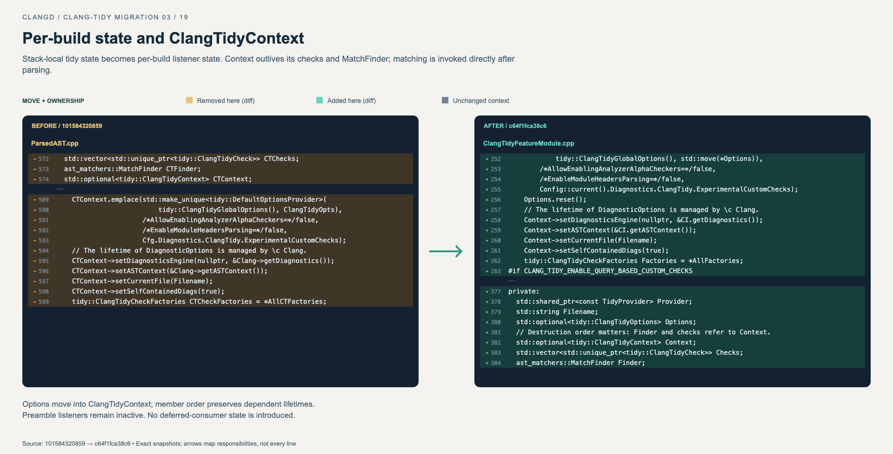

[Scalable image](assets/03-context.svg)

- Options move into ClangTidyContext; member order preserves dependent lifetimes.
- Preamble listeners remain inactive. No deferred-consumer state is introduced.
- Context, checks and finder keep their original roles. Their member declaration order ensures dependent state is destroyed first.

### 4. Factories, custom checks and callback registration

**MOVE + ADAPT.** Check setup moves into beforePPCallbacks(), after BeginSourceFile and before clangd captures callbacks for preamble replay. The registry here is ClangTidyModuleRegistry (check factories), not FeatureModuleRegistry. Custom-check registration, its mutex, fast-check filtering and PP/matcher registration are retained.

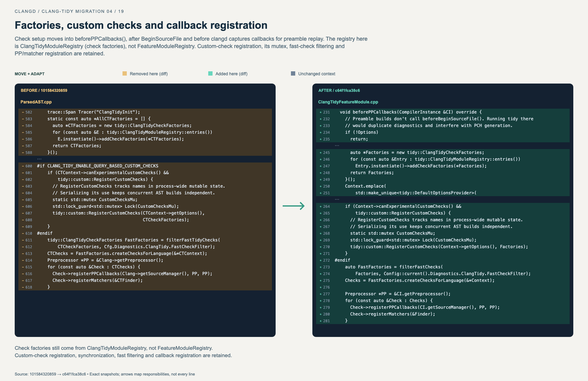

[Scalable image](assets/04-checks.svg)

- Check factories still come from ClangTidyModuleRegistry, not FeatureModuleRegistry.
- Custom-check registration, synchronization, fast filtering and callback registration are retained.
- The registry shown here is ClangTidyModuleRegistry for check factories, not FeatureModuleRegistry.

### 5. AST matching is a direct afterExecute call

**MOVE + ADAPT.** The same MatchFinder call moves from ParsedAST into afterExecute(). Tokens are collected and traversal scope is restricted first, as before.

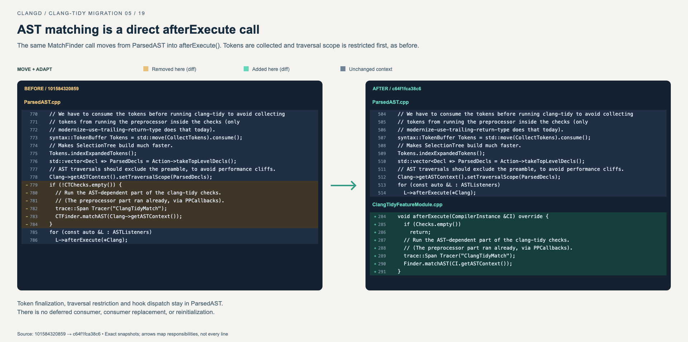

[Scalable image](assets/05-match.svg)

- Token finalization, traversal restriction and hook dispatch stay in ParsedAST.
- There is no deferred consumer, consumer replacement, or reinitialization.
- afterExecute runs after token collection and traversal restriction, before PP.EndSourceFile(). This preserves the original matching order.

### 6. Existing hooks; no consumer replacement

**EXISTING INTERFACE.** The listener implements the existing FeatureModule interface. Matching runs directly in afterExecute; no new AST-consumer adapter is needed.

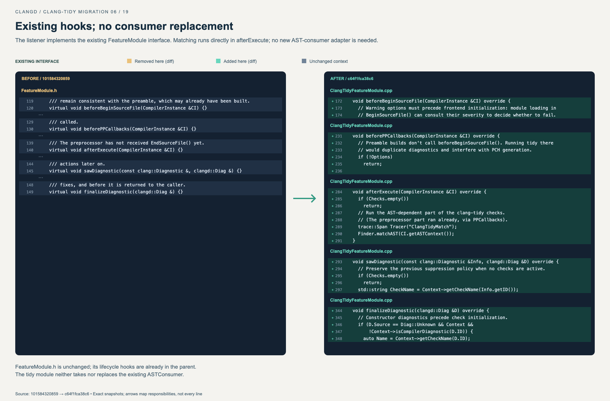

[Scalable image](assets/06-multiplex.svg)

- FeatureModule.h is unchanged; its lifecycle hooks are already in the parent.
- The tidy module neither takes nor replaces the existing ASTConsumer.
- The historical figure anchor is retained, but consumer multiplexing has been removed from the implementation.

### 7. Diagnostic suppression and severity policy

**MOVE + POLICY PRESERVED.** The tidy-specific level adjuster moves to sawDiagnostic(), which edits the assembled diagnostic. Retains clangd suppression, NOLINT, system-macro filtering and warnings-as-errors. The nonempty-check guard is preserved: without active checks, tidy suppression and promotion remain disabled.

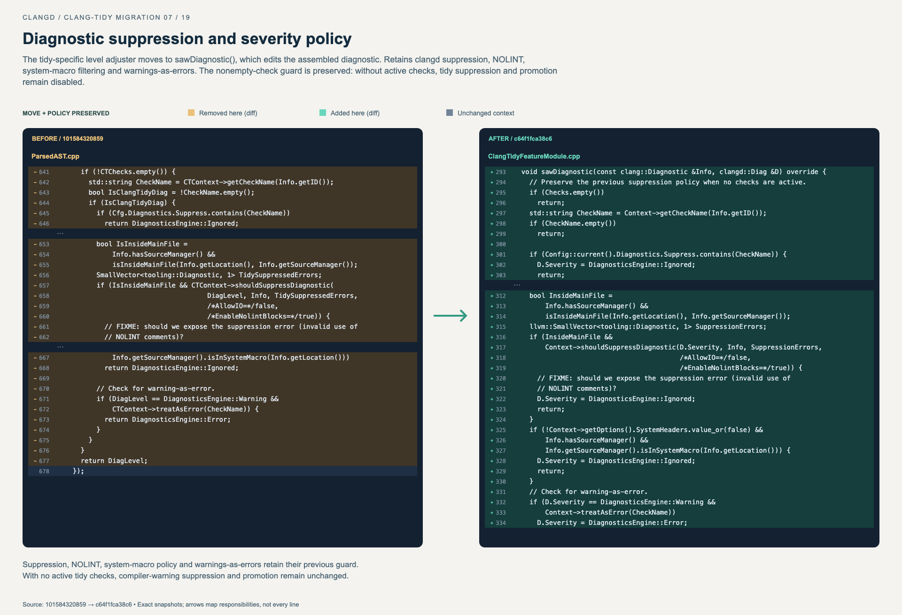

[Scalable image](assets/07-filtering.svg)

- Suppression, NOLINT, system-macro policy and warnings-as-errors retain their previous guard.
- With no active tidy checks, compiler-warning suppression and promotion remain unchanged.
- The nonempty-check guard preserves the pre-migration policy; changing it to a context-only guard would change compiler-warning behavior.

### 8. Diagnostic names and source move out of StoreDiags

**MOVE + GENERIC FALLBACK.** The listener identifies tidy diagnostics; StoreDiags no longer receives a ClangTidyContext and preserves supplied metadata. Compiler diagnostics retain their Clang source and -W name. Flushing, compiler metadata fallback, generic finalizer dispatch and deduplication stay in StoreDiags.

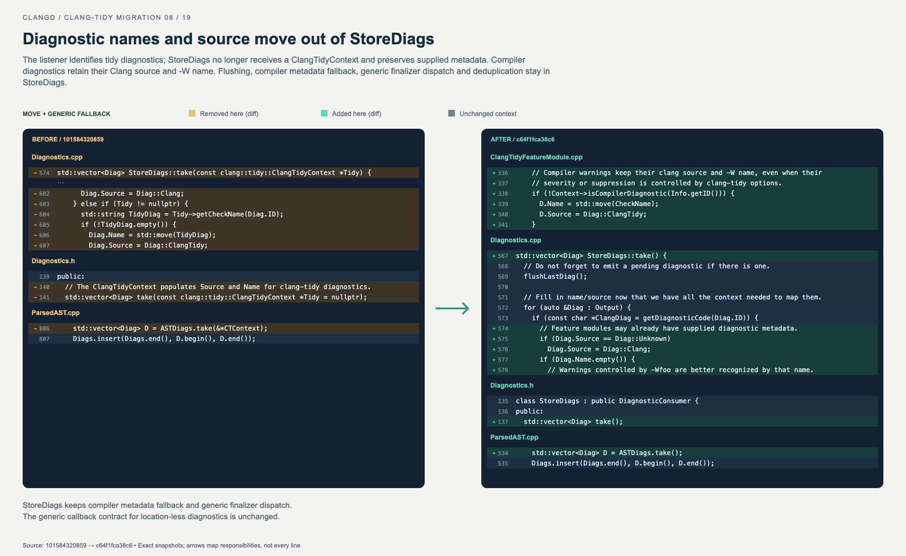

[Scalable image](assets/08-metadata.svg)

- StoreDiags keeps compiler metadata fallback and generic finalizer dispatch.
- The generic callback contract for location-less diagnostics is unchanged.
- StoreDiags::take() no longer needs a tidy context. Flushing, compiler metadata fallback, generic finalizers and deduplication remain in core code.

### 9. Message cleanup and tidy-specific tags

**MOVE + SMALL GUARD.** Message cleanup and tidy tags move into finalizeDiagnostic(), after notes and fixes are assembled. Constructor errors get tidy metadata here because they precede check initialization. Cleanup still covers messages, notes and fixes; containment checks avoid duplicate tags.

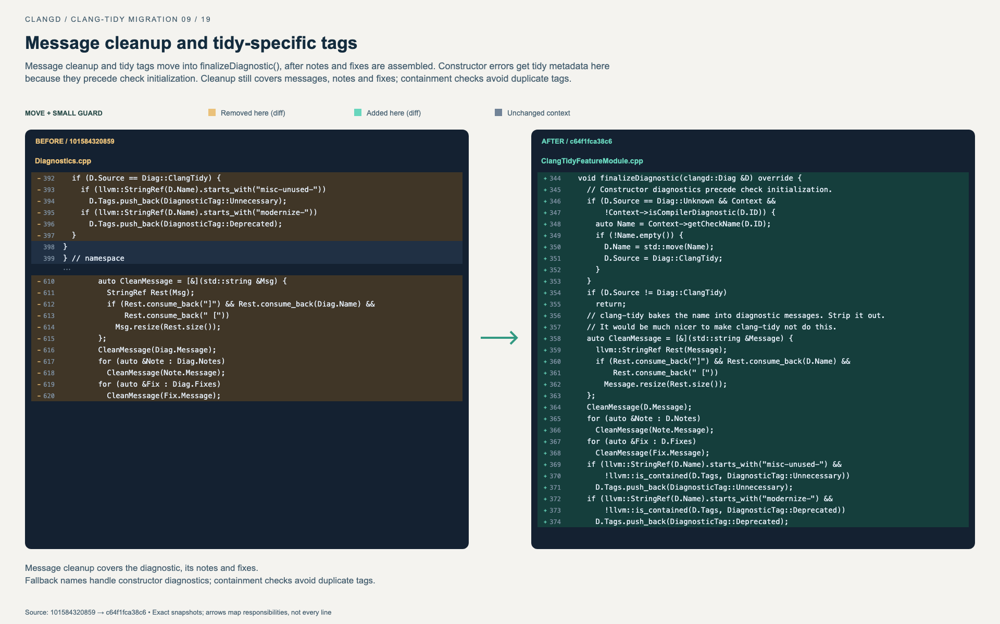

[Scalable image](assets/09-finalize.svg)

- Message cleanup covers the diagnostic, its notes and fixes.
- Fallback names handle constructor diagnostics; containment checks avoid duplicate tags.
- Existing cleanup comments and FIXMEs move with the corresponding logic.

### 10. Application wiring replaces the provider plumbing

**APPLICATION WIRING.** ClangdMain explicitly creates the tidy module only when EnableClangTidy is true. Server and ParseInputs retain their existing generic FeatureModules forwarding.

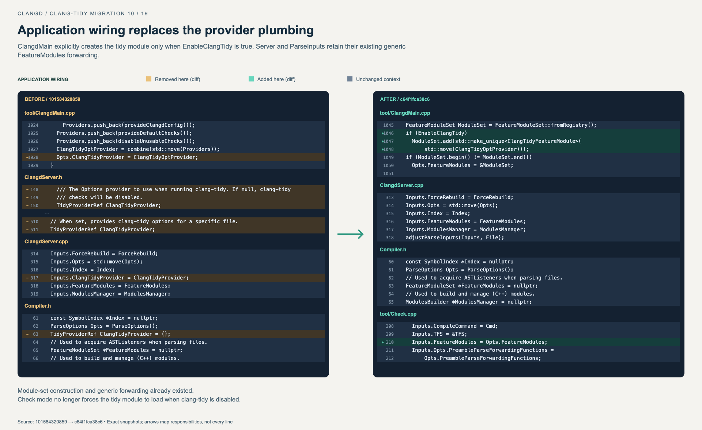

[Scalable image](assets/10-wiring.svg)

- Module-set construction and generic forwarding already existed.
- Check mode no longer forces the tidy module to load when clang-tidy is disabled.
- --check alone does not force the module to load. Combining --clang-tidy=0 with --check-tidy-time is no longer supported.

### 11. Module-owned provider snapshots

**NEW OWNERSHIP.** A module owns the options provider. Each listener captures a shared snapshot, allowing later provider replacement. An empty provider disables new listeners. Existing listeners keep their captured provider. This ownership and synchronization code is new, not relocated from ParsedAST.

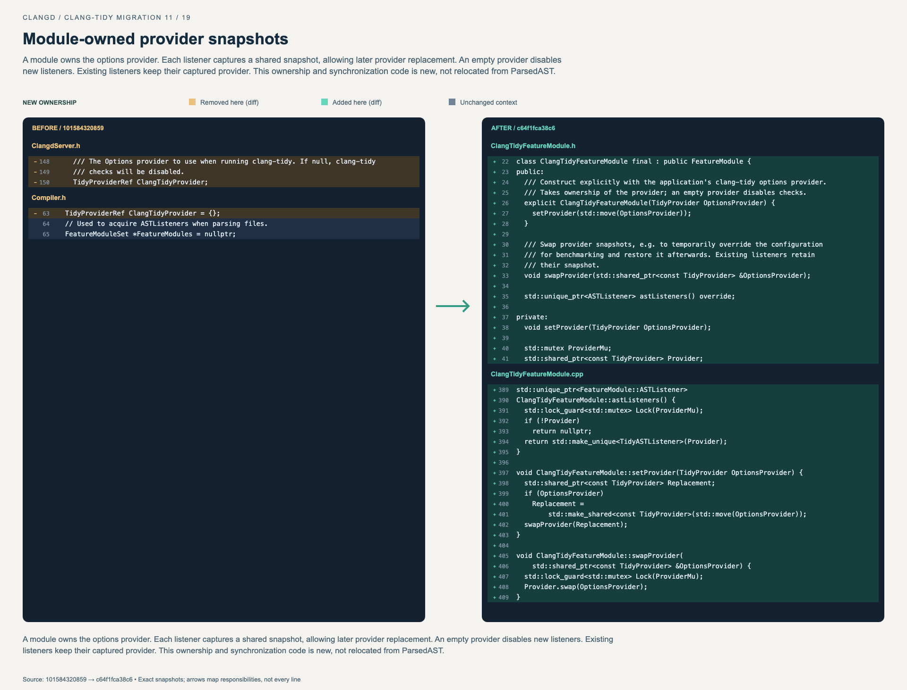

[Scalable image](assets/11-provider.svg)

- A module owns the options provider. Each listener captures a shared snapshot, allowing later provider replacement. An empty provider disables new listeners. Existing listeners keep their captured provider. This ownership and synchronization code is new, not relocated from ParsedAST.
- A private construction helper and public snapshot swap support temporary overrides; no default registry construction is introduced.

### 12. Check-mode timing swaps only tidy's provider

**TIMING ADAPTER.** Timing temporarily swaps only tidy's provider, leaving other modules active. Clang-tidy must be enabled; a missing module produces an error.

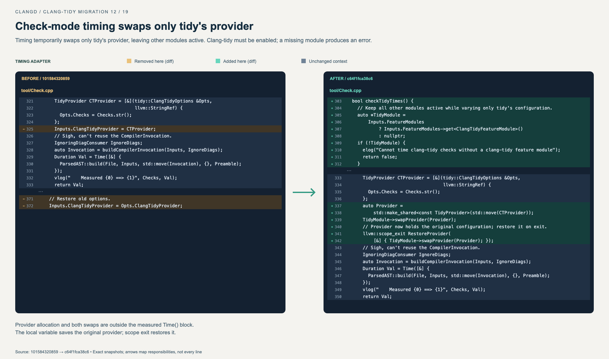

[Scalable image](assets/12-benchmark.svg)

- Provider allocation and both swaps are outside the measured Time() block.
- The local variable saves the original provider; scope exit restores it.
- The missing-module guard reports an error instead of inserting a module into a caller-owned set. Ordinary timing still works with clang-tidy enabled.

### 13. TestTU keeps the short test configuration

**TEST HELPER ADAPTER.** Tests may still assign TU.ClangTidyProvider. build() wraps it in a local module; inputs() only forwards explicit modules. ClangTidyProvider and FeatureModules are mutually exclusive in TestTU::build(). Mixed-module tests and direct inputs() callers use an explicit module set. This is a deliberate test-helper boundary.

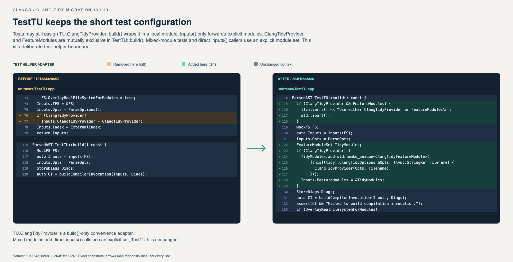

[Scalable image](assets/13-testtu.svg)

- TU.ClangTidyProvider is a build()-only convenience adapter.
- Mixed modules and direct inputs() calls use an explicit set; TestTU.h is unchanged.
- The convenience fields ClangTidyProvider and FeatureModules remain mutually exclusive in TestTU::build(). Direct inputs() calls must supply modules explicitly.

### 14. Server and LSP tests register a feature module

**TEST SETUP ADAPTERS.** Tests embedding the server replace the removed options field with an explicitly constructed tidy module. The existing test inputs and assertions are retained; only setup changes. The LSP fixture already supplies its FeatureModuleSet to the server.

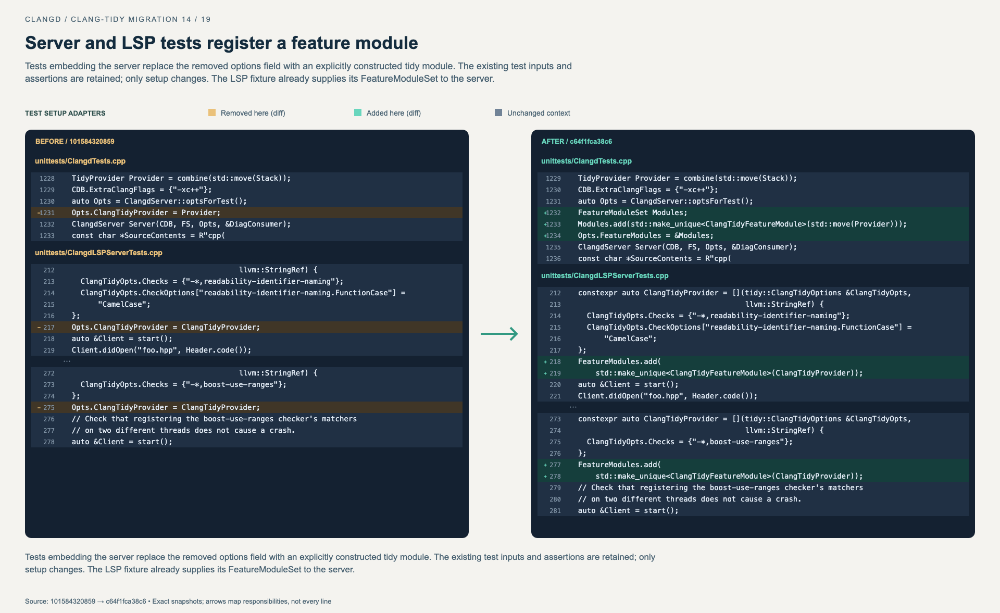

[Scalable image](assets/14-server-tests.svg)

- Tests embedding the server replace the removed options field with an explicitly constructed tidy module. The existing test inputs and assertions are retained; only setup changes. The LSP fixture already supplies its FeatureModuleSet to the server.
- Existing test code and assertions are retained; setup changes to the new configuration mechanism.

### 15. IncludeFixer and orchestration stay in the core

**STAYS IN CORE.** IncludeFixer stays in ParsedAST; colors show reindentation and rewrites within the same core file. Clang's typo-correction adjustment, include fixes, token collection and lifecycle dispatch remain in the core. Preamble.cpp and FeatureModule.h are unchanged; the existing lifecycle hooks are reused.

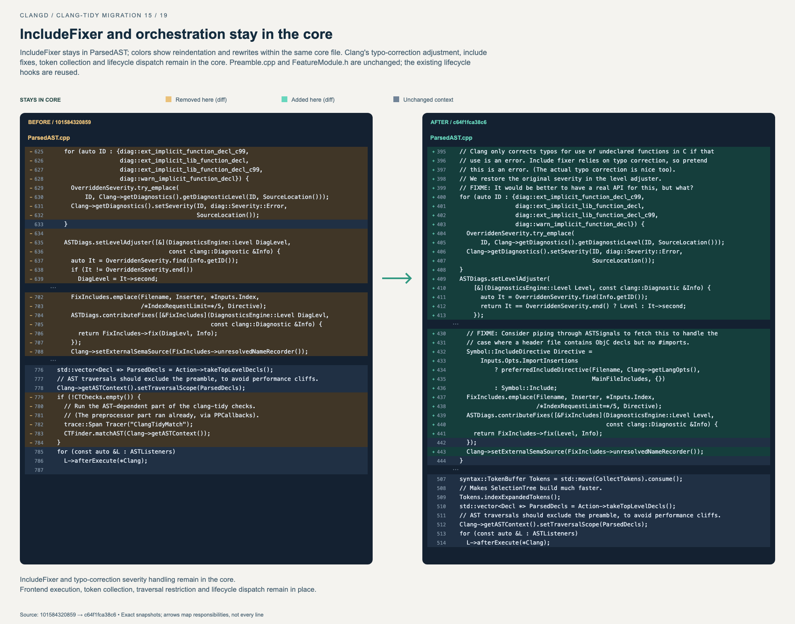

[Scalable image](assets/15-stays.svg)

- IncludeFixer and typo-correction severity handling remain in the core.
- Frontend execution, token collection, traversal restriction and lifecycle dispatch remain in place.
- FeatureModule.h, Preamble.cpp and TestTU.h are unchanged by this commit. Colored IncludeFixer lines represent same-file reindentation/rewiring, not extraction.

### 16. Existing regressions are reused, not re-added

**TEST SETUP ADAPTERS.** The parent already contains the zero-check, warning-option, relative-input and consumer-initialization tests. The migration adapts their setup.

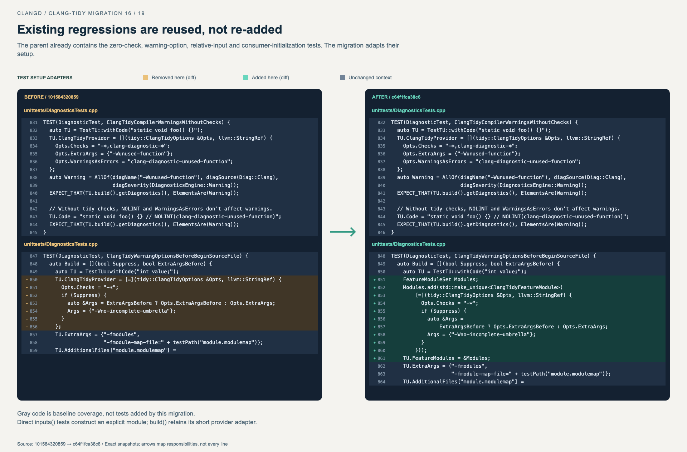

[Scalable image](assets/16-build-tests.svg)

- Gray code is baseline coverage, not tests added by this migration.
- Direct inputs() tests construct an explicit module; build() retains its short provider adapter.
- All four baseline regressions were added before the migration. They are not new functionality or newly introduced tests in this patch.

### 17. Filename identity and temporary provider overrides

**ADAPT + ONE NEW TEST.** Relative-input coverage already exists in the parent; its provider is wired through a module. The provider-swap regression is new.

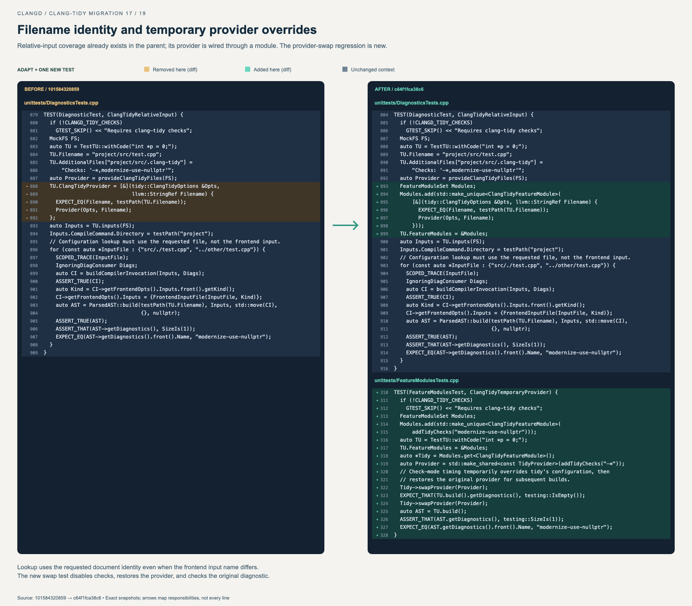

[Scalable image](assets/17-paths-provider.svg)

- Lookup uses the requested document identity even when the frontend input name differs.
- The new swap test disables checks, restores the provider, and checks the original diagnostic.
- The differing frontend input is an artificial low-level test. Normal CommandMangler handling already aligns the input with the requested document.

### 18. CMake and GN compile the new module

**BUILD WIRING.** Both build descriptions add the same ClangTidyFeatureModule.cpp source. No lit test is introduced by this commit.

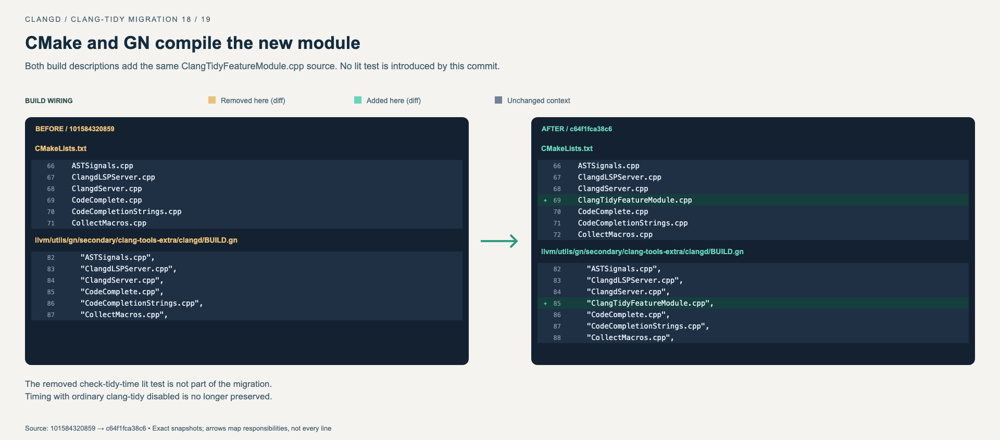

[Scalable image](assets/18-diagnostic-build.svg)

- The removed check-tidy-time lit test is not part of the migration.
- Timing with ordinary clang-tidy disabled is no longer preserved.
- There is no check-tidy-time.test in either selected snapshot.

### 19. Code moves together with its original comments

**CODE + ORIGINAL COMMENTS.** Original explanatory comments and existing FIXMEs move with their code. Comment wording is preserved, allowing indentation and line wrapping changes. New adapter comments are separate.

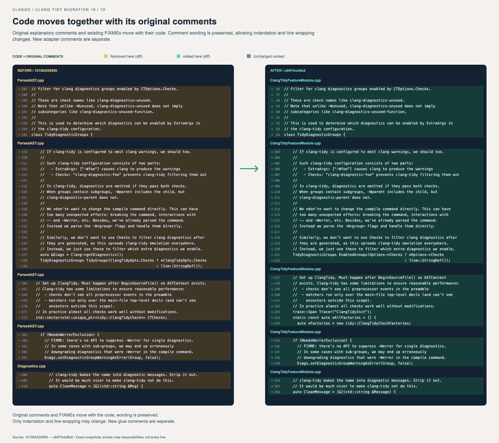

[Scalable image](assets/19-comments.svg)

- Original comments and FIXMEs move with the code; wording is preserved.
- Only indentation and line wrapping may change. New glue comments are separate.
- Five paired examples show helper documentation, warning-option rationale, existing limitations, a FIXME and diagnostic cleanup. Their wording matches after ignoring whitespace and line wrapping.

## Coverage of all changed files

All 17 changed files are accounted for below. The figures group related responsibilities rather than showing every diff hunk. The complete patch is included in [migration.patch](migration.patch).

| File (under clang-tools-extra/clangd/) | Change | Figure(s) |
| --- | --- | --- |
| [`CMakeLists.txt`](https://github.com/ArcsinX/llvm-project/blob/c64f1fca38c610faa448c14c5336808087b1996e/clang-tools-extra/clangd/CMakeLists.txt) | Compile the module source | 18 |
| [`ClangTidyFeatureModule.cpp`](https://github.com/ArcsinX/llvm-project/blob/c64f1fca38c610faa448c14c5336808087b1996e/clang-tools-extra/clangd/ClangTidyFeatureModule.cpp) | Move tidy options, checks, direct matching, diagnostic policy and original comments; add provider ownership | 1–12 |
| [`ClangTidyFeatureModule.h`](https://github.com/ArcsinX/llvm-project/blob/c64f1fca38c610faa448c14c5336808087b1996e/clang-tools-extra/clangd/ClangTidyFeatureModule.h) | Explicit module API and provider snapshots | 11 |
| [`ClangdServer.cpp`](https://github.com/ArcsinX/llvm-project/blob/c64f1fca38c610faa448c14c5336808087b1996e/clang-tools-extra/clangd/ClangdServer.cpp) | Remove tidy-provider forwarding; retain generic module forwarding | 10 |
| [`ClangdServer.h`](https://github.com/ArcsinX/llvm-project/blob/c64f1fca38c610faa448c14c5336808087b1996e/clang-tools-extra/clangd/ClangdServer.h) | Remove dedicated tidy-provider fields | 10–11 |
| [`Compiler.h`](https://github.com/ArcsinX/llvm-project/blob/c64f1fca38c610faa448c14c5336808087b1996e/clang-tools-extra/clangd/Compiler.h) | Remove the tidy-specific ParseInputs field/include | 10–11 |
| [`Diagnostics.cpp`](https://github.com/ArcsinX/llvm-project/blob/c64f1fca38c610faa448c14c5336808087b1996e/clang-tools-extra/clangd/Diagnostics.cpp) | Move tidy metadata, cleanup and tags; retain generic diagnostics handling | 8–9 |
| [`Diagnostics.h`](https://github.com/ArcsinX/llvm-project/blob/c64f1fca38c610faa448c14c5336808087b1996e/clang-tools-extra/clangd/Diagnostics.h) | Remove the ClangTidyContext parameter from take() | 8 |
| [`ParsedAST.cpp`](https://github.com/ArcsinX/llvm-project/blob/c64f1fca38c610faa448c14c5336808087b1996e/clang-tools-extra/clangd/ParsedAST.cpp) | Extract tidy logic; retain frontend orchestration and IncludeFixer | 1–7, 15 |
| [`tool/Check.cpp`](https://github.com/ArcsinX/llvm-project/blob/c64f1fca38c610faa448c14c5336808087b1996e/clang-tools-extra/clangd/tool/Check.cpp) | Forward the module set and temporarily swap the tidy provider for timing | 10, 12 |
| [`tool/ClangdMain.cpp`](https://github.com/ArcsinX/llvm-project/blob/c64f1fca38c610faa448c14c5336808087b1996e/clang-tools-extra/clangd/tool/ClangdMain.cpp) | Construct the tidy module only when clang-tidy is enabled | 10 |
| [`unittests/ClangdLSPServerTests.cpp`](https://github.com/ArcsinX/llvm-project/blob/c64f1fca38c610faa448c14c5336808087b1996e/clang-tools-extra/clangd/unittests/ClangdLSPServerTests.cpp) | Adapt two LSP tests to explicitly add the tidy module | 14 |
| [`unittests/ClangdTests.cpp`](https://github.com/ArcsinX/llvm-project/blob/c64f1fca38c610faa448c14c5336808087b1996e/clang-tools-extra/clangd/unittests/ClangdTests.cpp) | Adapt server-test setup to explicitly add the tidy module | 14 |
| [`unittests/DiagnosticsTests.cpp`](https://github.com/ArcsinX/llvm-project/blob/c64f1fca38c610faa448c14c5336808087b1996e/clang-tools-extra/clangd/unittests/DiagnosticsTests.cpp) | Adapt existing warning-option and filename tests; zero-check coverage already exists | 16–17 |
| [`unittests/FeatureModulesTests.cpp`](https://github.com/ArcsinX/llvm-project/blob/c64f1fca38c610faa448c14c5336808087b1996e/clang-tools-extra/clangd/unittests/FeatureModulesTests.cpp) | Add provider-swap coverage and adapt existing consumer-test setup | 17 |
| [`unittests/TestTU.cpp`](https://github.com/ArcsinX/llvm-project/blob/c64f1fca38c610faa448c14c5336808087b1996e/clang-tools-extra/clangd/unittests/TestTU.cpp) | Retain the build-only provider convenience adapter | 13 |
| [`llvm/utils/gn/secondary/clang-tools-extra/clangd/BUILD.gn`](https://github.com/ArcsinX/llvm-project/blob/c64f1fca38c610faa448c14c5336808087b1996e/llvm/utils/gn/secondary/clang-tools-extra/clangd/BUILD.gn) | Compile the module source in GN | 18 |

## Sharing

[Published walkthrough](https://arcsinx.github.io/clang-tidy-feature-module-walkthrough/) · [Download ZIP](clang-tidy-migration.zip). Share the README and assets folder together. index.html embeds all vector diagrams and the complete patch, so it can also be shared as a standalone file.

The source-map.json file records all 1004 displayed lines. The five paired comment examples preserve wording after ignoring indentation and wrapping.
